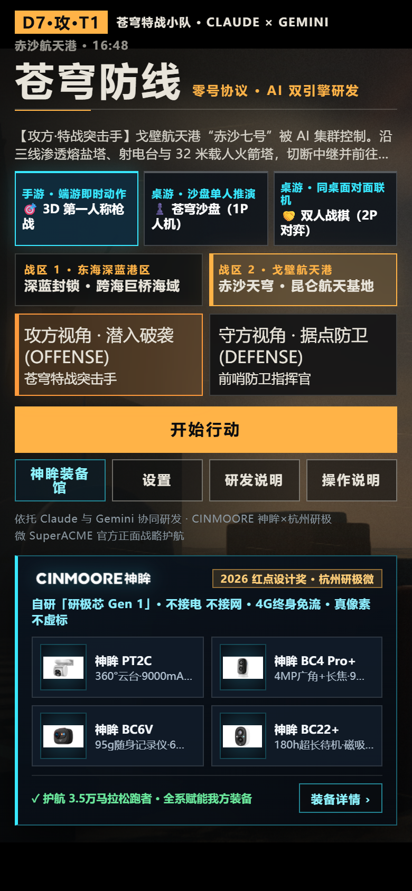
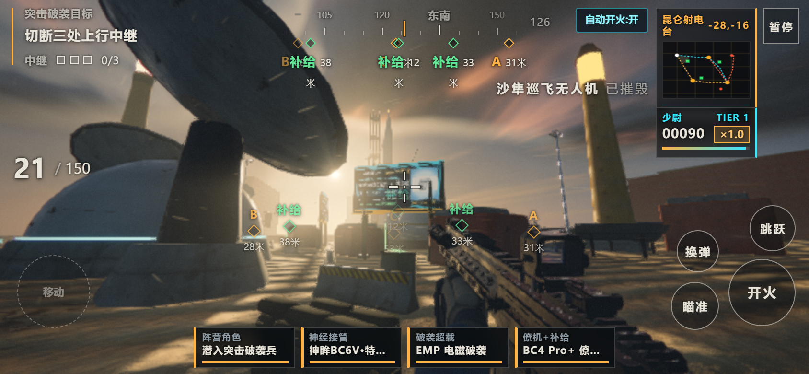
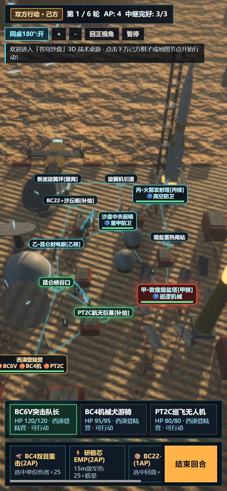
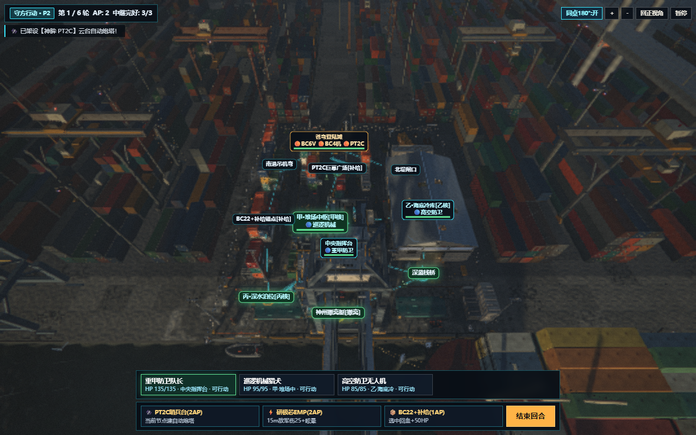

# SKYLINE PROTOCOL · 苍穹引擎·零号协议 (`v3.1.0`)

<p align="center">
  <strong>Zero-Dependency 3D WebGL FPS × 1P/2P Tabletop Wargame Engine · Mobile-First · Dual-Preset Open Source · AI-Agent Playbooks</strong>
</p>

**Skyline Protocol** (**苍穹防线 · 零号协议**) is an open-source **Three.js r180 single-file WebGL engine + modular assembler** that turns the same procedural 3D battlefields (*East Sea Deep Blue Harbor* & *Red Sand Spaceport*) into **three seamlessly switchable experiences** inside any desktop or mobile browser—with zero backend servers, zero runtime npm dependencies, and automated Headless Chrome CDP WebGL2 QA.

> **Open Source Name**: `skyline-protocol` (**苍穹引擎·零号协议**)  
> **Live Play (GitHub Pages)**: Enable Pages in repo settings to serve directly at `https://guduzhixing.github.io/skyline-protocol/` (or open `index.html` / `dist/skyline-protocol-open.html` directly!).

---

## ✨ Why This Project Exists (对大众 & 对个人开发者)

- **For Everyday Players (对大众)**: Open a single URL on your phone and play immediately—solo 3D FPS with smart cone aim-assist & auto-fire, or set the phone flat on a cafe/dining table for **1P tactical sandtable** or **2P Face-to-Face Pass-and-Play Tabletop** with automatic **180° board flip**!
- **For WebGL & Game Developers (对开发者)**: A complete, runnable blueprint solving painful mobile WebGL issues: portrait/landscape 4-quadrant HUD separation, invisible overlay `pointer-events` traps, PointerLock mobile crashes, 3D-to-2D safe-zone marker clamping, and zero-dependency Chrome CDP WebGL2 automated testing (`npm run qa`).
- **For AI Coding Agents (对 Agent / Copilot 协同开发)**: Ships **`AGENTS.md`**, **`CLAUDE.md`**, and **6 field-tested Engineering Playbooks** ([`docs/agent-playbook/`](./docs/agent-playbook)) showing how to safely modularize and evolve a `1.6 MB` Three.js bundle without breaking closures or UI layouts.
- **Clean License & Brand Separation (双模式合规开源)**:
  - **`--mode=showcase`** (`index.html`, `1,641,797 B`): Includes the full interactive positive hardware showcase integration (**CINMOORE 神眸 / SuperACME**, covered separately under [`THIRD_PARTY_NOTICES.md`](./THIRD_PARTY_NOTICES.md)).
  - **`--mode=pure`** (`dist/skyline-protocol-open.html`, `1,571,882 B`): Replaces every third-party logo and trademark with MIT-clean SVG vector emblems and neutral designations (`SENTRY-X1`, `DUO-EYE`, `TAC-CAM`, `SUPPLY-POD`), automatically verified to have **`brandHitsInDOM: 0`**.

---

## 📸 Verified Multi-Viewport Showcase

| Mobile Portrait Title (`390×844`) | Mobile Portrait FPS (`390×844`) | Mobile Landscape FPS (`844×390`) |
| :---: | :---: | :---: |
|  |  |  |

| 1P Tabletop Portrait (`390×844`) | 2P Face-to-Face Handoff (`180° Flip`) | Desktop Ocean Tabletop (`1280×800`) |
| :---: | :---: | :---: |
|  |  |  |

---

## 🚀 Quickstart (`Node.js >= 20`, Zero npm Dependencies)

```bash
git clone https://github.com/guduzhixing/skyline-protocol.git
cd skyline-protocol

# 1. Start instant dev server & get Mobile LAN URL for testing on your phone over Wi-Fi:
npm run dev

# 2. Rebuild BOTH Showcase (index.html) and Pure Neutral Open Edition (dist/skyline-protocol-open.html):
npm run build:all

# 3. Run ES syntax check (node --check), required runtime anchor audit & pure brand-neutrality check:
npm run check

# 4. Run Headless Chrome CDP + SwiftShader WebGL2 5-Matrix End-to-End QA:
npm run qa
```

---

## 🏗️ Repository Architecture

```text
skyline-protocol/
├── AGENTS.md                        # AI-Agent quick manifest, minified symbol glossary & invariants
├── CLAUDE.md                        # Claude Code entry pointer
├── README.md
├── LICENSE                          # MIT License (code, modular tooling, playbooks, neutral edition)
├── THIRD_PARTY_NOTICES.md           # Explicit IP boundary between MIT engine & showcase PNGs
├── CONTRIBUTING.md
├── CHANGELOG.md
├── package.json                     # Zero runtime dependencies (Node >= 20 built-ins only)
├── index.html                       # Compiled single-file Showcase edition (1,641,797 B)
├── dist/
│   ├── skyline-protocol-standalone.html  # Standalone Showcase artifact
│   └── skyline-protocol-open.html        # 100% MIT-clean Neutral Open edition (1,571,882 B)
├── assets/presets/superacme/        # Hardware showcase PNGs referenced by superacme-showcase.json
├── src/
│   ├── core/engine-base.html        # Verified V2 Three.js r180 base engine (1,590,585 B)
│   ├── styles/
│   │   ├── mobile-responsive.css    # 4-quadrant mobile HUD, portrait/landscape, ghost trap fixes
│   │   └── tabletop-ui.css          # #tt-ui, node markers, bottom pawn/card dock, #tt-handoff
│   ├── modules/
│   │   ├── mobile-input-aim.js      # IS_TOUCH_DEV, PointerLock guard, cone aim-assist, gyro, auto-fire
│   │   └── tabletop-engine.js       # 11-node TT_MAPS, 1P AI, 2P 180° flip, dynamic safe clamping
│   └── presets/
│       ├── superacme-showcase.json  # Showcase asset preset mapping
│       └── open-neutral.json        # Inline SVG vector emblems & neutral string replacement table
├── scripts/
│   ├── build.mjs                    # Deterministic Slot/Overlay Assembler (--mode=showcase | pure)
│   ├── verify-build.mjs             # Extracted-script node --check + anchor & neutrality verification
│   ├── dev-server.mjs               # Zero-dep HTTP server printing local + Mobile LAN URLs
│   └── cdp-qa/
│       ├── layout-audit.mjs         # CDP session, real touch dispatch, bbox overlap/OOB checker
│       └── run-4matrix-qa.mjs       # Automated 5-matrix WebGL2 QA writing latest-qa-report.json
└── docs/
    ├── OPEN_SOURCE_STRATEGY.md      # Deep analysis: Public Utility × Personal Value × Licensing
    ├── architecture/
    │   ├── ENGINE_SUBSYSTEMS.md     # Closure module map & state machine architecture
    │   └── CUSTOMIZATION_GUIDE.md   # How to add custom presets, 11-node maps, cards & HUD elements
    ├── benchmarks/
    │   ├── DATA_AND_BENCHMARKS.md   # Verified sizes, progression tables & live CDP telemetry
    │   └── latest-qa-report.json    # Machine-generated QA output from `npm run qa`
    ├── showcase/                    # Verified headless Chrome WebGL2 screenshots (8 scenarios)
    └── agent-playbook/              # 6 actionable engineering guides distilled for AI Agents & Devs
        ├── 01-slot-overlay-assembler-vs-naive-splitting.md
        ├── 02-mobile-4quadrant-hud-and-ghost-pointer-traps.md
        ├── 03-3d-fps-to-tabletop-pass-and-play-architecture.md
        ├── 04-headless-chrome-cdp-webgl2-automated-qa.md
        ├── 05-asymmetric-balance-and-progression-design.md
        └── 06-claude-gemini-multi-agent-coengineering-workflow.md
```

---

## 📊 Verified QA Gate Summary (`npm run qa`)

Latest run recorded in [`docs/benchmarks/latest-qa-report.json`](./docs/benchmarks/latest-qa-report.json) (`54,568 ms`):
- **Portrait FPS (`390×844`)**: `12` active HUD elements audited -> **`overlaps: []`**, **`oob: []`**, zero lock prompt leaks, `#t-assist-btn` live toggle verified.
- **Landscape FPS (`844×390`)**: `is-landscape` active -> `12` elements audited -> **`overlaps: []`**, **`oob: []`**.
- **Tabletop 1P & 2P (`390×844` -> `844×390` -> `1280×800`)**: `11` 3D-projected node buttons clamped dynamically -> **`markerCollisions: 0`**, `#tt-handoff` triggers smooth **`3.142 rad` (`180°`)** target camera flip, debrief preserves tabletop title, exit cleans `tabletop-board` children to **`0`**.
- **Desktop Regression (`1440×900`)**: `isTouchClass: false`, `billboardsAfterDeploy: 3`, `fatal: null`.
- **Pure Open Edition Boot (`dist/skyline-protocol-open.html`)**: `fatal: null`, **`brandHitsInDOM: 0`**.
- **Global Errors**: **`runtimeErrors: []`**.

---

## 🤝 Contributing & License

- Code, tooling, playbooks, and the `--mode=pure` neutral distribution are licensed under **[MIT](./LICENSE)**.
- Third-party hardware trademarks/assets used in `--mode=showcase` are scoped strictly under **[THIRD_PARTY_NOTICES.md](./THIRD_PARTY_NOTICES.md)**.
- See **[CONTRIBUTING.md](./CONTRIBUTING.md)** before submitting pull requests.
