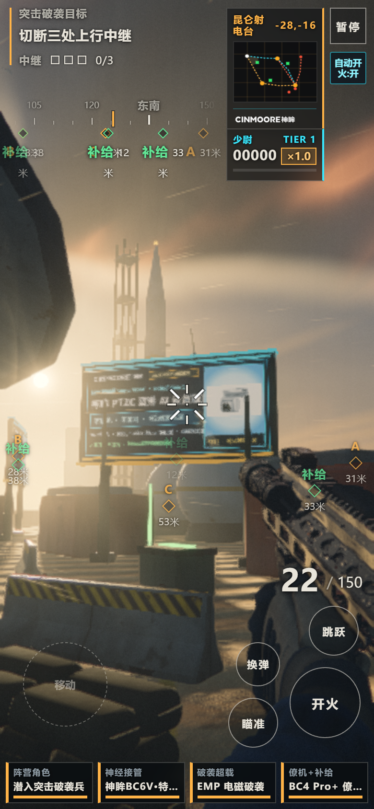
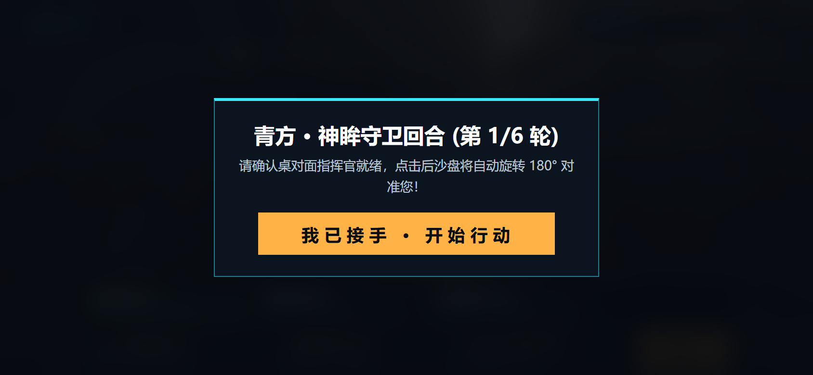

# 苍穹防线：零号协议（Skyline Protocol）

> **零后端依赖的 WebGL2 3D 第一人称射击 & 1P / 2P 面对面战棋双栖游戏引擎** — 同时为大众玩家、前端/游戏开发者以及 AI 编程智能体（Agent）提供开箱即用的双模式单文件架构与系统化工程方法论。

[](LICENSE)
[](package.json)
[](docs/benchmarks/DATA_AND_BENCHMARKS.md)
[](THIRD_PARTY_NOTICES.md)

- **在线试玩（品牌展示版 / Showcase，默认构建）**：https://guduzhixing.github.io/skyline-protocol/
- **在线试玩（100% 纯净开源版 / Pure Open Edition，零第三方商标）**：https://guduzhixing.github.io/skyline-protocol/dist/skyline-protocol-open.html
- **GitHub 开源仓库**：https://github.com/guduzhixing/skyline-protocol

---

## 为什么值得开源与关注

大多数 HTML5 / Three.js 演示工程往往是一次性的封闭 Demo，很难直接复用。`skyline-protocol` 通过**双模态单一代码库**与**多 Agent 工程剧本（Playbook）**，从三类人群的真实需求出发解决这一问题：

1. **对大众与普通玩家**
   - **点开即玩、无需下载安装包**：桌面鼠标键盘、手机竖屏、手机横屏、面对面传玩一机搞定；没有应用商店门槛，离线拷贝单一 HTML 文件即可在浏览器运行。
   - **同屏双栖体验**：同一套 3D 战场既可以进入高速 60fps 第一人称战术射击（`FPS 模式`），也可以随时切换为 11 节点回合制 3D 沙盘兵棋推演（`1P 单人指挥` / `2P 双人面对面传玩`），系统在回合交接时自动执行 180° 相机翻转。
2. **对独立开发者与个人成长**
   - **“源码模块化 + 分发单文件”构建范式**：在 `src/` 下分层维护 CSS、响应式输入、战棋模块与 JSON 主题预设，通过零依赖构建器 [scripts/build.mjs](scripts/build.mjs) 合成可直接托管在 GitHub Pages 或 CDN 的零外部请求单文件 HTML。
   - **双版本合规分发模板**：清晰演示如何通过 `--mode=showcase` 与 `--mode=pure`（[open-neutral.json](src/presets/open-neutral.json)）把商用品牌资产与 MIT 开源主代码解耦，既保留完整商业演示示例，又确保下游 fork 拥有无版权/商标争议的纯净开源版本。
3. **对 AI 编程智能体（Codex / Antigravity / Claude Code / Gemini）**
   - **`docs/agent-playbook/` 实战经验库**：把“闭包源码槽位叠加器架构”“移动端四象限 HUD 与幽灵 `pointer-events` 陷阱”“3D 战棋安全区投影夹紧”“零外部依赖 Chrome CDP + SwiftShader 无头 WebGL2 自动化验收”等真实踩坑全部沉淀为可复用规范。
   - **全自动化 5 矩阵 CDP 验收流水线**：[run-4matrix-qa.mjs](scripts/cdp-qa/run-4matrix-qa.mjs) 直接驱动无头 Chrome 在 SwiftShader 软件渲染环境下验证手机竖屏 `390×844`、手机横屏 `844×390`、1P/2P 战棋翻转、桌面回归以及纯净开源版 DOM 净化情况。

---

## 核心截图展示（V3.1 实测）

| 手机竖屏大厅（390×844） | 手机竖屏 FPS 四象限 HUD | 手机横屏 FPS 自动射击 |
| :---: | :---: | :---: |
|  |  |  |
| **1P 手机竖屏 3D 战棋** | **2P 面对面回合交接遮罩（180° 翻转）** | **桌面端东海海空 3D 战棋俯瞰** |
|  |  |  |

> 更多完整验证截图与数据请查看：[数据与基准测试报告](docs/benchmarks/DATA_AND_BENCHMARKS.md) 以及 `docs/showcase/` 目录（还包含桌面端大厅回归 [v3_desktop_title_regression.png](docs/showcase/v3_desktop_title_regression.png) 与战棋结算 [v3_tabletop_debrief.png](docs/showcase/v3_tabletop_debrief.png)）。

---

## 快速开始

### 环境要求
- **Node.js `>= 22.0.0`**（零第三方 `npm` 依赖，原生使用 Node 内置模块及 Global `WebSocket`）。
- 如需运行自动化视觉 QA：本机需安装任意基于 Chromium 的浏览器（Chrome / Edge / Chromium），脚本会自动探测路径或读取环境变量。

### 常用命令

```bash
# 1. 进入仓库目录（零 npm install 成本）
cd skyline-protocol

# 2. 同时构建展示版（showcase）与纯净开源版（pure）单文件 HTML
npm run build:all

# 3. 快速静态校验（JS 语法检查、Pure 版品牌残留归零检查、双产物对比，耗时 < 1 秒）
npm run check

# 4. 启动本地开发与静态预览服务器
npm run dev

# 5. 运行完整的 5 矩阵无头 Chrome CDP + WebGL2 视觉布局与交互回归测试
npm run qa
```

---

## 仓库目录结构与核心资产大小

```text
skyline-protocol/
├── index.html                                     # GitHub Pages 入口（展示版单文件 HTML，1,642,122 B）
├── package.json                                   # 工程脚本清单（type: "module"，零第三方依赖）
├── LICENSE                                        # MIT 开源许可证原文
├── AGENTS.md                                      # AI Agent 核心架构契约与不可破坏不变量
├── CLAUDE.md                                      # Claude / Codex 协作者入口规范
├── CONTRIBUTING.md                                # 贡献指南与 PR 准入门槛
├── CHANGELOG.md                                   # V1.0 -> V3.1 完整演进日志
├── THIRD_PARTY_NOTICES.md                         # Three.js r180 与预设品牌资产免责声明
├── .github/workflows/
│   └── ci-and-pages.yml                           # GitHub Actions CI 自动验证 + Pages 自动部署
├── src/
│   ├── core/
│   │   └── engine-base.html                       # 经验证的 V2 核心 WebGL2/Three.js 单闭包基线引擎（1,590,585 B）
│   ├── styles/
│   │   ├── mobile-responsive.css                  # 移动端 4 象限响应式 HUD 与幽灵点击屏蔽样式（12,811 B）
│   │   └── tabletop-ui.css                        # 3D 战棋顶栏/底栏、兵棋悬浮节点与 2P 交接界面样式（5,929 B）
│   ├── modules/
│   │   ├── mobile-input-aim.js                    # 触屏自适应、双摇杆、圆锥辅助瞄准与自动开火槽位补丁（10,359 B）
│   │   └── tabletop-engine.js                     # 11 节点拓扑地图、AI 决策、AP 经济与 180° 双人翻转引擎（37,080 B）
│   └── presets/
│       ├── superacme-showcase.json                # 展示版品牌硬件预设映射配置（502 B）
│       └── open-neutral.json                      # 纯净开源版内联 SVG 与中性战术名词替换清单（4,704 B）
├── assets/presets/superacme/                      # 展示版 PNG 贴图原件（3,642 B ~ 13,595 B）
├── dist/
│   ├── skyline-protocol-standalone.html           # 独立分发展示版（1,642,122 B）
│   └── skyline-protocol-open.html                 # 100% 开源合规纯净版（1,572,207 B）
├── scripts/
│   ├── build.mjs                                  # 槽位叠加构建器（--mode=showcase | --mode=pure）
│   ├── dev-server.mjs                             # 本地 HTTP 预览服务
│   ├── verify-build.mjs                           # <1s 语法与纯净度静态门禁
│   └── cdp-qa/
│       ├── layout-audit.mjs                       # DOM 重叠（>2px）与越界（OOB）几何审计器
│       └── run-4matrix-qa.mjs                     # 5 矩阵无头 Chrome CDP + SwiftShader WebGL2 全自动测试套件
└── docs/
    ├── OPEN_SOURCE_STRATEGY.md                    # 开源价值定位、受众分析与三阶段路线图
    ├── architecture/
    │   ├── ENGINE_SUBSYSTEMS.md                   # 构建流水线与 4 大运行时子系统深度拆解
    │   └── CUSTOMIZATION_GUIDE.md                 # 自定义主题预设、地图拓扑、战术卡与移动端 HUD 扩展指南
    ├── benchmarks/
    │   ├── DATA_AND_BENCHMARKS.md                 # 构建体积演变、QA 时序基准与数值参数汇总
    │   └── latest-qa-report.json                  # 最近一次实测 5 矩阵 Chrome CDP QA 完整 JSON 遥测
    ├── showcase/                                  # 实测视觉回归高清截图（8 张）
    └── agent-playbook/                            # 面向 AI Agent 与人类开发者的 6 篇实战工程剧本
        ├── 01-slot-overlay-assembler-vs-naive-splitting.md
        ├── 02-mobile-4quadrant-hud-and-ghost-pointer-traps.md
        ├── 03-3d-fps-to-tabletop-pass-and-play-architecture.md
        ├── 04-headless-chrome-cdp-webgl2-automated-qa.md
        ├── 05-asymmetric-balance-and-progression-design.md
        └── 06-claude-gemini-multi-agent-coengineering-workflow.md
```

---

## 文档导航总览

| 文档分类 | 文档链接 | 核心内容 |
| :--- | :--- | :--- |
| **Agent 必读契约** | [AGENTS.md](AGENTS.md) / [CLAUDE.md](CLAUDE.md) | 引擎关键压缩符号表、6 条不可破坏工程不变量与标准验收流程 |
| **开源全景战略** | [docs/OPEN_SOURCE_STRATEGY.md](docs/OPEN_SOURCE_STRATEGY.md) | 大众价值、个人复利、双预设版权隔离机制与三阶段路线图 |
| **系统架构与二次开发** | [ENGINE_SUBSYSTEMS.md](docs/architecture/ENGINE_SUBSYSTEMS.md) · [CUSTOMIZATION_GUIDE.md](docs/architecture/CUSTOMIZATION_GUIDE.md) | 槽位构建原理、5 态机与战棋引擎交互、地图/预设/战术卡修改手册 |
| **基准测试与遥测** | [DATA_AND_BENCHMARKS.md](docs/benchmarks/DATA_AND_BENCHMARKS.md) · [latest-qa-report.json](docs/benchmarks/latest-qa-report.json) | 5 矩阵实测数据（最近一次全量通过耗时 `52,526 ms`、零运行时异常、零 HUD 重叠） |
| **Agent 工程剧本 01–06** | `docs/agent-playbook/01..06` | 闭包叠加器、手机四象限 HUD 与幽灵点击修复、FPS/战棋同源共享、CDP 自动化、非对称数值、多 Agent 协同 |

---

## 自动化 QA 验证摘要（最近一次完整实测）

来自 [docs/benchmarks/latest-qa-report.json](docs/benchmarks/latest-qa-report.json)（执行时间：`2026-11-14T16:33:56.279Z`，总耗时 `52,526 ms`，运行时报错 `0`）：

- **矩阵 A（手机竖屏 `390×844`）**：`12` 个 HUD 元素零重叠（`overlaps: []`）、零越界（`oob: []`），`DEPLOY` 主按钮居中无遮挡（`top: 385, bottom: 429`），3 枚模式胶囊切换正常，无误触桌面指针锁定提示（`hasLockPrompt: false`），`自动开火:开` ↔ `仅手控:关` 切换正常。
- **矩阵 B（手机横屏 `844×390`）**：挂载 `["is-touch", "is-landscape"]`，12 个 HUD 控件分布于两侧拇指安全区，零重叠、零越界。
- **矩阵 C（3D 战棋 1P / 2P 传玩）**：竖屏 11 节点棋盘安全区投影零碰撞（`markerCollisions: 0`）；横屏 2P 传玩触发交接遮罩，确认换手后相机平稳完成目标 `3.142 rad`（实测 `3.117 rad`）180° 翻转；退出重进后战棋 DOM 完全清理（`ttRem: 0`）。
- **矩阵 D（桌面端 `1440×900` 回归）**：未误触发触屏类（`isTouchClass: false`），全 3 块真实 3D 广告/战术牌可见（`billboardsAfterDeploy: 3`），进入正常 FPS 模式（`fpsState: "playing"`）。
- **矩阵 E（纯净开源版引导校验）**：`dist/skyline-protocol-open.html` 零致命异常启动（`fatal: null`），DOM 第三方品牌关键词残留 `brandHitsInDOM: 0`。

---

## 贡献与开源许可

- **贡献规范**：请先阅读 [CONTRIBUTING.md](CONTRIBUTING.md) 与 [AGENTS.md](AGENTS.md)，确保所有代码修改均在 `src/` 或 `scripts/` 中完成，并通过 `npm run build:all && npm run check && npm run qa`。
- **许可证说明**：引擎核心代码、构建脚本与本仓库原创工程文档采用 **MIT License**（见 [LICENSE](LICENSE)）。`src/presets/superacme-showcase.json` 与 `assets/presets/superacme/*` 中展示的第三方商业硬件品牌名称及图片资产不适用 MIT 授权；如需纯净商用或二次分发，请使用 `npm run build:pure` 生成 [dist/skyline-protocol-open.html](dist/skyline-protocol-open.html)。详情请参阅 [THIRD_PARTY_NOTICES.md](THIRD_PARTY_NOTICES.md)。
